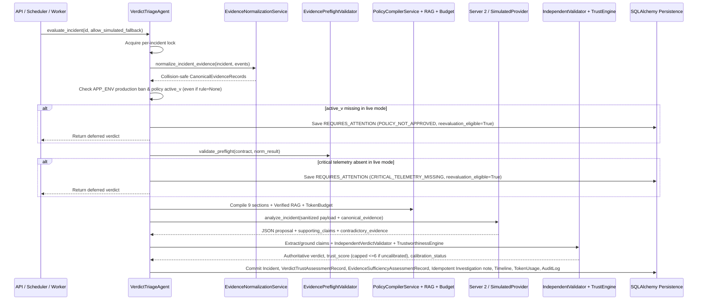

# Incident-to-Verdict End-to-End Runtime Flow

- **Updated At:** 2026-11-10T19:55:00+05:30
- **Repository Commit:** `0148142` (`0148142f3abd6dad87a903b90f7b25edb8d41def`)
- **Architecture Version:** `AIS 2.1 + Audit Remediation v2.2.1`
- **Primary Source Modules:** [`ai_verdict_service.py`](file:///c:/Users/amit/OneDrive/Documents/SOC-AI-Agent/backend/app/services/ai_verdict_service.py), [`evidence_normalization_service.py`](file:///c:/Users/amit/OneDrive/Documents/SOC-AI-Agent/backend/app/services/evidence_normalization_service.py), [`independent_verdict_validator.py`](file:///c:/Users/amit/OneDrive/Documents/SOC-AI-Agent/backend/app/services/independent_verdict_validator.py), [`verdict_trustworthiness_engine.py`](file:///c:/Users/amit/OneDrive/Documents/SOC-AI-Agent/backend/app/services/verdict_trustworthiness_engine.py)

---

## 1. End-to-End Execution Pipeline

Every incident enters triage either synchronously on demand (`POST /api/incidents/{id}/ai-verdict`), in bounded background batches after ingestion (`fortisiem_service.py`), or asynchronously via `VerdictTriageAgent.reconcile_pending_triage()`.

```mermaid
flowchart TD
    A["1. Ingestion (FortiSIEM / JSON / ZIP)<br/>ZipGuard & Allowlist Sanitization"] --> B["2. Acquire Event-Loop Per-Incident Lock<br/>VerdictTriageAgent._get_incident_lock()"]
    B --> C["3. Evidence Normalization<br/>EvidenceNormalizationService -> CanonicalEvidenceRecord + SHA-256"]
    C --> D["4. Strict Ground-Truth Isolation<br/>build_model_facing_payload() (zero resolution/comments leakage)"]
    D --> E{"5. Live Availability & Policy Guard<br/>Approved Rule + PromptVersion?"}
    E -->|LLM Offline & !allow_mock| F1["Raise LocalLLMUnavailableError (HTTP 503)<br/>Incident remains ai_verdict=None"]
    E -->|No Approved Policy (!active_v)| F2["Abstain: REQUIRES_ATTENTION (0%)<br/>POLICY_NOT_APPROVED + reevaluation_eligible=True"]
    E -->|Approved Policy Exists| G["6. RuleEvidenceContract + PreflightValidator"]
    G -->|Critical Telemetry Missing| F3["Abstain: REQUIRES_ATTENTION (0%)<br/>CRITICAL_TELEMETRY_MISSING + reevaluation_eligible=True"]
    G -->|Preflight OK| H["7. PolicyCompiler V3 (9 secs) + Verified Semantic RAG + TokenBudgetService"]
    H -->|Core Exceeds Window| F4["Abstain: REQUIRES_ATTENTION (0%)<br/>CONTEXT_WINDOW_EXCEEDED + reevaluation_eligible=True"]
    H -->|Within Budget| I["8. Inference Provider<br/>OpenAICompatible (or SIMULATED in dev/test only)"]
    I --> J["9. Claim Extraction & Grounding<br/>ModelClaimExtractor (V3 & P2 schemas)"]
    J --> K["10. IndependentVerdictValidator<br/>8 Checks + No Empty-Claim or Blanket-FP Bypass"]
    K --> L["11. Unified AIS 2.1 Trust Engine<br/>EvidenceSufficiency + ClaimValidator + Guardrails + Real Calibration Stats"]
    L -->|Safety Guardrail or Validator Rejects| M1["Authoritative Verdict = REQUIRES_ATTENTION (0%)"]
    L -->|Validated & Grounded| M2["Authoritative Verdict = TRUE_POSITIVE or FALSE_POSITIVE"]
    M1 --> N["12. Authoritative Persistence<br/>Incident + TrustRecord + SufficiencyRecord + Idempotent Investigation + Timeline + Tokens + AuditLog"]
    M2 --> N
```

---

## 2. Detailed Sequence & Decision Contracts



---

## 3. Remediated Runtime Safeguards & Reevaluation Paths

1. **Zero Unapproved Policy Leakage:** When `active_v` is `None` (whether `rule` exists with DRAFTs OR `rule is None` on orphan alerts), non-simulated live evaluation abstains cleanly with `POLICY_NOT_APPROVED` and flags `reevaluation_eligible = True`.
2. **No Empty-Claim Decisive Bypass:** `IndependentVerdictValidator` and `VerdictGuardrailsEngine` both require at least one grounded supporting claim (`grounded_claims >= 1`) to accept `TRUE_POSITIVE` or `FALSE_POSITIVE`.
3. **AIS 2.1 Live Integration Without False Confidence:** Live triage invokes `VerdictTrustworthinessEngine.evaluate_verdict_trust(...)` using real database historical sample counts and empirical accuracy (via `PolicySimulationService.get_rule_calibration_stats`), persists `VerdictTrustAssessmentRecord` + `EvidenceSufficiencyAssessmentRecord`, and reconciles hard safety guardrails (`G1/G2/G3/G4/G6/G7`) directly onto the final authoritative verdict while preserving cold-start uncalibrated transparency (`trust_score <= 6/10`, `calibration_status = "NOT_CALIBRATED"` when `< 30` cases).
4. **Authoritative Downstream Audit Consistency:** If the deterministic validator overrides a model `TRUE_POSITIVE (97%)` proposal to `REQUIRES_ATTENTION (0%)`, downstream `Investigation.analyst_notes`, `TelemetryTimelineRecord`, `TokenUsageRecord`, and `AuditLog` record authoritative `REQUIRES_ATTENTION (0%)` alongside the raw `proposed_verdict` for forensic traceability.
5. **Bounded Recovery & Reevaluation:** Calling `PromptStudioService.approve_version()` queues a bounded background reevaluation (`reconcile_pending_triage(max_batch=15, include_reevaluation_eligible=True, rule_id=...)`), bounded by `reevaluation_attempts < 3`, preventing runaway loops while recovering incidents that previously deferred for `POLICY_NOT_APPROVED` or `EVIDENCE_MISSING`.

